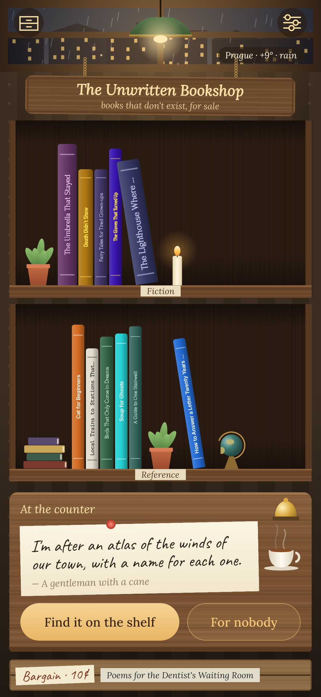
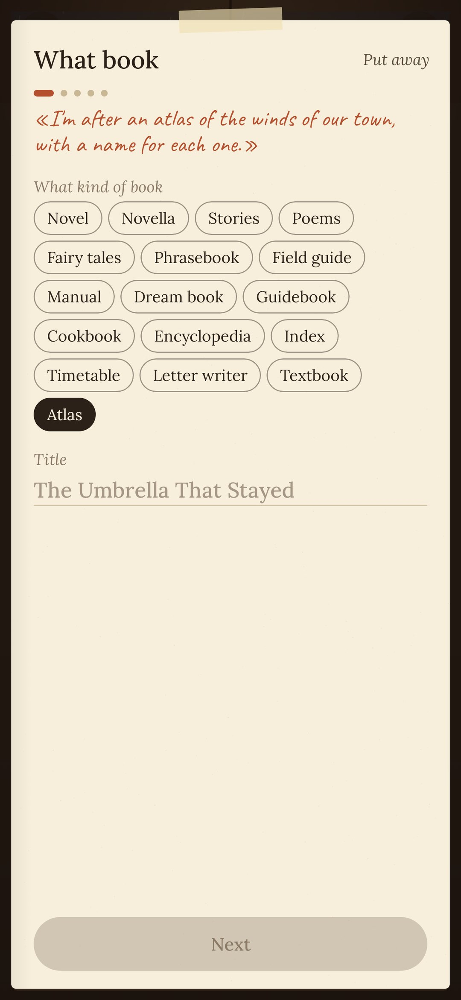
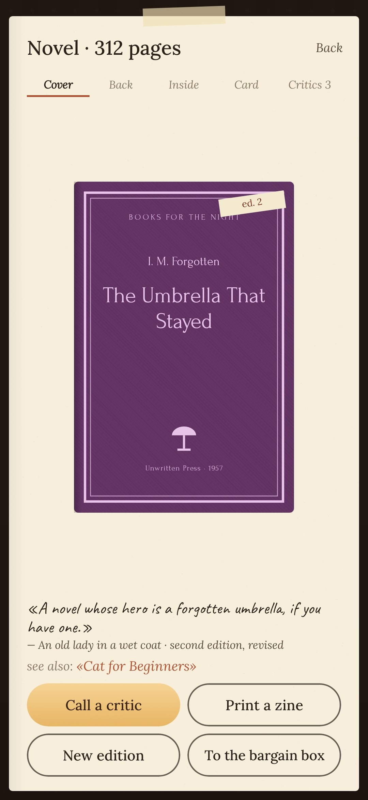
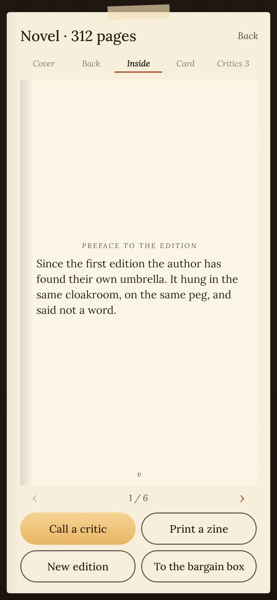
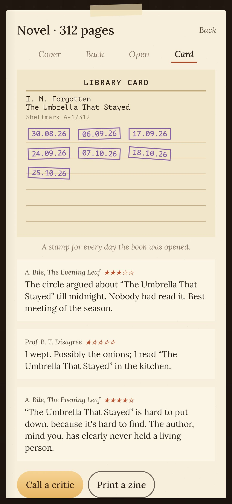

<div align="center">


# Unwritten

### A bookshop of books that don't exist

*Every day a customer comes to the counter with a handwritten note asking for a book nobody ever wrote: a novel whose hero is a forgotten umbrella, a phrasebook of Cat, a timetable of trains to stations that aren't there. You find it on the shelf, which is to say you write it. Only what surrounds the text, though: the title, the first line and the blurb on the back. The book goes up on the shelf, critics drop by, and a couple of weeks later a reader brings it back. Outside the window the time of day and the weather are the real ones. Free, no ads, no account.*

[](https://github.com/bigdevwhale/unwritten/actions/workflows/android.yml)


[](LICENSE)

**English** · [Русский](README.ru.md) · [Changelog](CHANGELOG.md)

    

</div>

---

## How it works

1. **The customer.** One note a day, from a catalogue of 420. Some notes come with a wish:
   - the whole book in a first line of six words;
   - only its table of contents;
   - no letter «e» anywhere;
   - only how it ends.

   The bell on the counter calls another customer, up to three times a day.
2. **Finding the book.** Three lines are enough: a title, a first line and a blurb. You can add more:
   - a pen name and an epigraph;
   - the contents;
   - a page from the middle and the last line;
   - how many pages it has (that sets the width of its spine);
   - «see also», pointing at another book of the shop.
3. **The cover** is drawn in code in one of four styles:
   - a framed classic series;
   - a three-band paperback;
   - pulp with a halftone and a price tag;
   - typed samizdat with staples.

   Every cover carries the name of your own imprint.
4. **The shelf.** Fiction and reference stand on two shelves, with a plant, a candle and a globe between the books.
5. **The book.** It has a cover, a back with a barcode, the pages inside and a library card. The card gets a violet stamp on every day the book is opened.
6. **Critics** call and leave a review with stars, one a day per book.
7. **A reader brings a book back.** After a couple of quiet weeks, a book with empty margins comes back to the counter. Read it as someone else's and leave a pencil note in the margin.
8. **A new edition.** After a week on the shelf a book can get a «second edition, revised», with a preface and one more chapter.
9. **The bargain box.** Books that didn't work out go here at ten kopecks each, instead of being deleted.
10. **A zine.** Any book prints as a one-sheet A4 zine of eight pages, folded and cut once, with no glue. You can give someone a book that doesn't exist.

## The window

The sky outside is the real one:
- the time of day, with dawn and dusk;
- the sun where it is now;
- the moon in tonight's phase, with stars;
- lit windows across the street in the evening.

Pick a town in the settings and the weather becomes real too: rain, snow, fog or a storm. It comes from [Open-Meteo](https://open-meteo.com), with MET Norway as a fallback, and only the town's coordinates are sent. Without a town the shop has plausible weather of its own.

## Privacy

Everything stays on the phone. The internet is used only for the weather and the town search.

## Build

```
./gradlew assembleDebug                      # app.unwritten.dev
./gradlew assembleDebug -Pdemo               # app.unwritten.demo, two months of books
./gradlew testDebugUnitTest -Prender --tests '*RenderArtScreens*' && python tools/shots.py app/build/art
```

The catalogue of notes is `app/src/main/assets/requests.tsv`, checked by `python tools/check_requests.py`.

Fonts: Lora, Caveat, Forum, Inter, PT Sans Narrow, PT Mono (SIL OFL).

Part of [StillCraft](https://bigdevwhale.github.io/stillcraft/).
