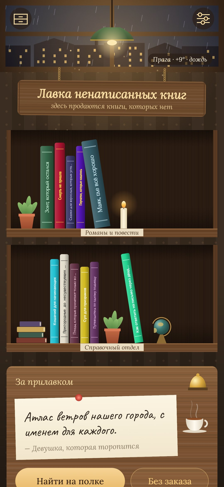
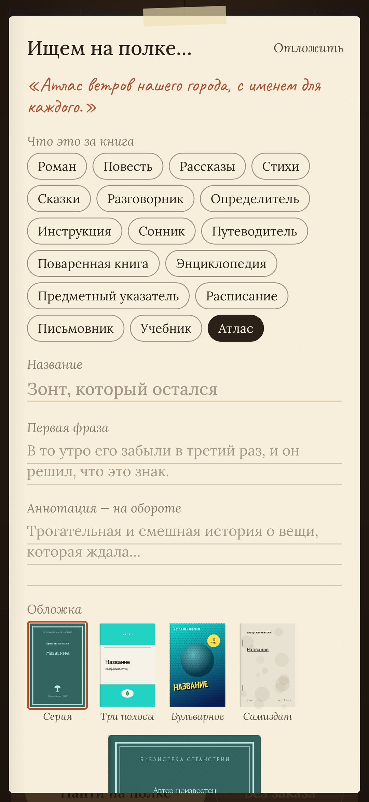
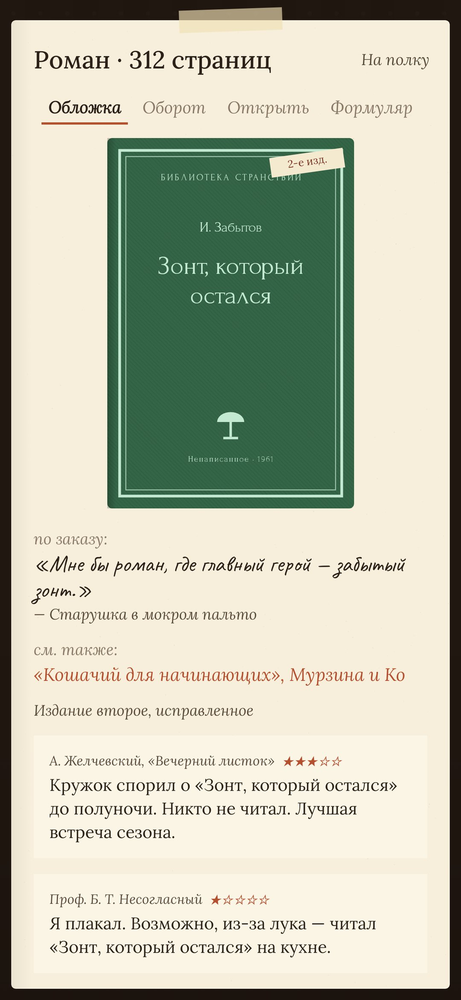
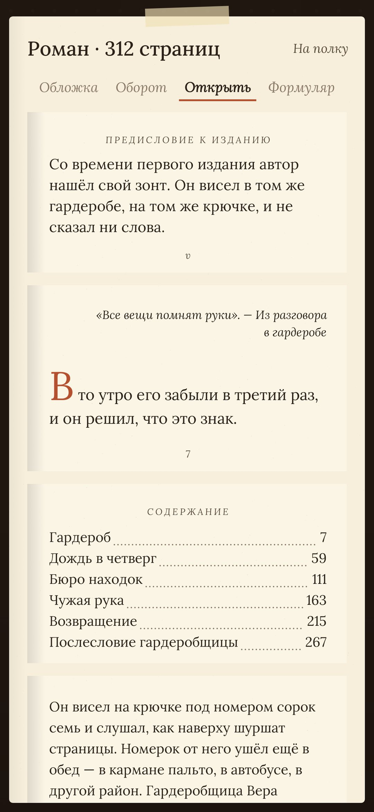
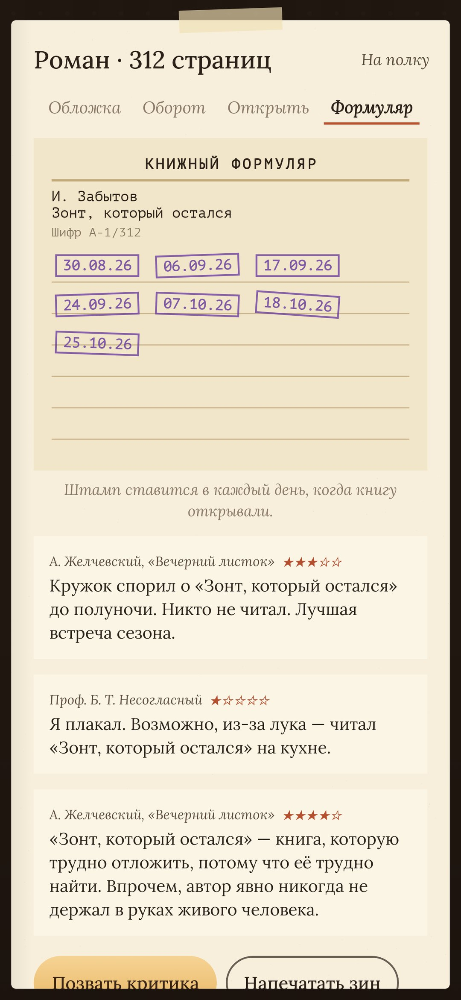

# Ненаписанное

### Лавка книг, которых нет

*Каждый день к прилавку подходит покупатель с запиской: ему нужна книга, которую никто никогда не писал. Роман, где главный герой — забытый зонт. Разговорник кошачьего. Расписание электричек до станций, которых нет на карте. Ты находишь её на полке — то есть пишешь. Но только то, что вокруг текста: название, первую фразу и аннотацию на обороте. Книга встаёт на полку, к ней заходят критики, а через пару недель её возвращает читатель. За окном настоящее время суток и настоящая погода. Бесплатно, без рекламы и аккаунта.*

[English](README.md) · **Русский** · [Изменения](CHANGELOG.md)

    

---

## Как это устроено

1. **Покупатель.** Одна записка в день из каталога на 420 штук. Иногда у покупателя особое желание:
   - вся книга в первой фразе из шести слов;
   - только оглавление;
   - ни одной буквы «о»;
   - только то, чем всё кончится.

   Колокольчик на прилавке зовёт другого покупателя, до трёх раз в день.
2. **Найти книгу.** Хватит трёх строк: названия, первой фразы и аннотации. По желанию можно добавить:
   - псевдоним и эпиграф;
   - оглавление;
   - страницу из середины и последнюю фразу;
   - число страниц (от него зависит толщина корешка);
   - «см. также» со ссылкой на другую книгу лавки.
3. **Обложка** рисуется в коде, на выбор одна из четырёх:
   - классическая серия в рамке;
   - книжка в три полосы;
   - бульварное издание с растром и ценником;
   - самиздат на машинке со скрепками.

   На каждой обложке стоит название твоего издательства.
4. **Полки.** Романы и справочный отдел стоят на двух полках, между книгами цветок, свеча и глобус.
5. **Книга.** У неё есть обложка, оборот со штрихкодом, страницы внутри и формуляр. На формуляре фиолетовый штамп за каждый день, когда книгу открывали.
6. **Критики** заходят и оставляют рецензию со звёздами, одну в день на книгу.
7. **Книгу возвращает читатель.** Книга с пустыми полями, которую пару недель не открывали, возвращается к прилавку. Перечитай её как чужую и оставь пометку карандашом.
8. **Новое издание.** Через неделю на полке у книги может выйти «издание второе, исправленное», с предисловием и ещё одной главой.
9. **Уценка.** Неудачные книги не удаляются, а уходят в ящик по 10 копеек.
10. **Зин.** Любую книгу можно напечатать как зин: лист A4, восемь страниц, один сгиб и один надрез, без клея. Можно подарить кому-нибудь книгу, которой нет.

## Окно

Небо за окном настоящее:
- время суток, с рассветом и закатом;
- солнце там, где оно сейчас;
- луна в сегодняшней фазе и звёзды;
- вечером горят окна в доме напротив.

Если выбрать город в настройках, погода тоже станет настоящей: дождь, снег, туман или гроза. Она берётся из [Open-Meteo](https://open-meteo.com), а если он недоступен, из MET Norway. Отправляются только координаты города. Без города у лавки своя правдоподобная погода.

## Приватность

Всё хранится на телефоне. Интернет нужен только для погоды и поиска города.

Часть [StillCraft](https://bigdevwhale.github.io/stillcraft/).
